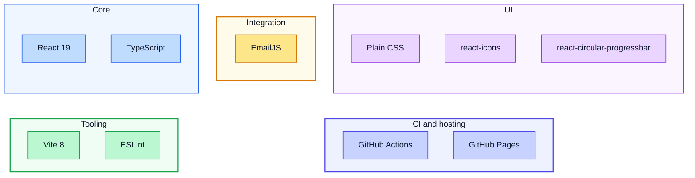
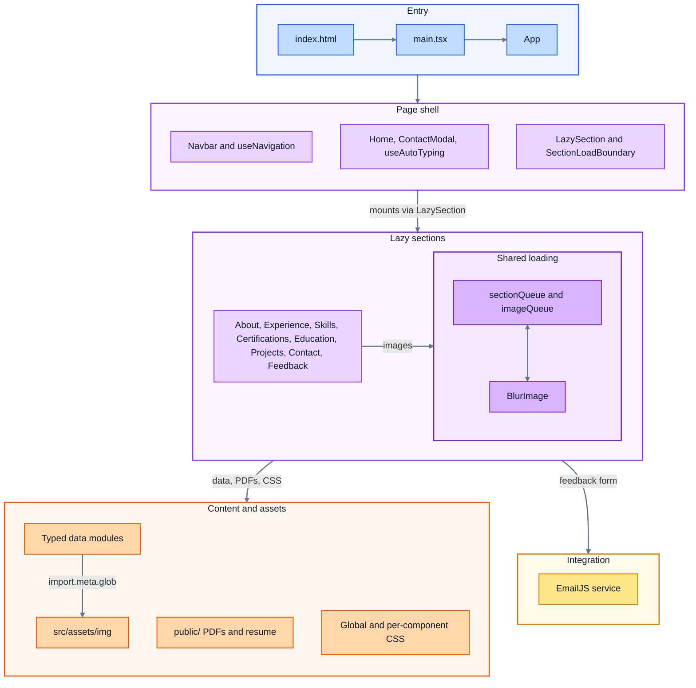
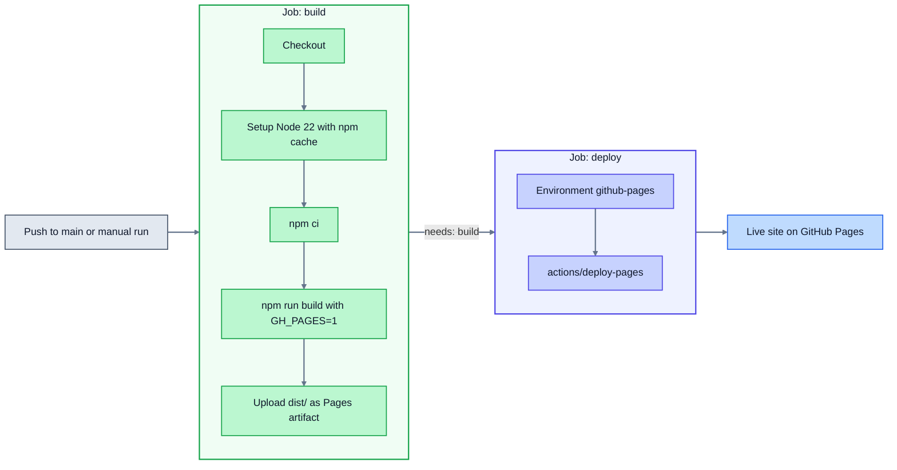

# Aniruddha Salvankar — Portfolio

A responsive single-page portfolio built with **React**, **TypeScript** and **Vite**.
It presents experience, skills, certifications, education and projects, with a progressive loading pipeline and automated deployment to GitHub Pages.


---

## Overview

A client-side React application with no backend. All content lives in typed data modules, and the only external service is [EmailJS](https://www.emailjs.com/), which delivers messages from the feedback form.

The page has nine sections, reached from a fixed sidebar: Home, About, Experience, Skills, Certifications, Education, Projects, Contact and Feedback.

**Live site:** [https://aniruddha-25.github.io/Portfolio/](https://aniruddha-25.github.io/Portfolio/)

## Key Features

| Feature | Details |
| --- | --- |
| Progressive section loading | Section shells render immediately and content mounts one section at a time. Jumping to a section mounts everything above it first, so the scroll position is accurate. |
| Background image queue | Images download one at a time after all sections have mounted. The queue pauses while scrolling or offline, images near the viewport jump the queue, and images fade in from a blur. |
| Scroll-aware navigation | Smooth scrolling and active-section highlighting. The sidebar becomes a hamburger menu on small screens. |
| Data-driven content | Experience, skills, certifications, education and projects render from typed data modules. Professional experience is computed from start dates and refreshes at midnight. |
| Certificate viewer | PDFs open in a modal with a progress ring driven by the bytes actually received. |
| Feedback form | Sends messages from the browser through EmailJS, so no backend is needed. |
| Hero and contact | A typing animation hook (`useAutoTyping`), a "Let's Connect" modal, and a downloadable [resume](public/Portfolio/Resume.pdf). |

## Technology Stack



| Dependency | Why it is used |
| --- | --- |
| `react`, `react-dom` | Reusable section components and simple state for modals, forms and navigation |
| `@emailjs/browser` | Sends feedback email from the client, avoiding a backend |
| `react-icons` | Tree-shakeable SVG icons (Font Awesome 6, Simple Icons, Tabler) |
| `react-circular-progressbar` | Certificate download progress ring |
| `vite`, `typescript`, `eslint` | Bundling, `tsc -b` type checking and linting |
| `gh-pages` | Backs the optional `npm run deploy` script |

React features used directly: `useState`, `useEffect`, `useRef` and `StrictMode`.

## Architecture

`index.html` loads `main.tsx`, which mounts `App` in `StrictMode`. `App` renders the sidebar, the home hero and eight sections, each wrapped in `LazySection`. Sections read typed data modules and share `BlurImage` for image loading.



### Progressive loading

Two small queues in [`src/components/lazy_section/`](src/components/lazy_section/) keep content ahead of images and avoid wasting bandwidth.

- A section scrolled into view, or targeted from the sidebar, bypasses the section queue.
- Image loading waits until all sections have mounted, so content always wins over images.
- When the browser comes back online, deferred and failed images resume automatically.

## Project Structure

```text
.github/workflows/deploy.yml   GitHub Pages workflow
public/                        Resume and certificate PDFs
src/
├── main.tsx, App.tsx          Entry point and page composition
├── styles/, index.css         Global styles
├── utils/                     Experience calculator
├── assets/img/                Logos, skill icons, project images
└── components/
    ├── navigation_bar/        Sidebar and useNavigation
    ├── lazy_section/          LazySection, section and image queues
    ├── blur_image/            BlurImage
    └── home/, about/, experience/, skills/, certifications/,
        education/, projects/, contact/, feedback/
```

## Getting Started

**Prerequisites:** [Node.js](https://nodejs.org/) 22 (the version used in CI) and npm.

**Git clone:**

```
git clone https://github.com/Aniruddha-25/Portfolio.git
```

**Navigate to project:**

```
cd Portfolio
```

**Install dependencies:**

```
npm install
```

**Start development server:**

```
npm run dev
```

The dev server listens on port **5000** (set in [`vite.config.ts`](vite.config.ts)), so open `http://localhost:5000`.

| Script | Description |
| --- | --- |
| `npm run dev` | Start the Vite development server |
| `npm run build` | Type-check with `tsc -b`, then build into `dist/` |
| `npm run preview` | Serve the production build locally (port 5000) |
| `npm run lint` | Run ESLint |
| `npm run deploy` | Manual publish to the `gh-pages` branch (see below) |

## Build and Deployment

The base path is set in [`vite.config.ts`](vite.config.ts): `/Portfolio/` when `GH_PAGES=1`, otherwise `/`. A local `npm run build` therefore serves from the site root, and CI sets the variable for GitHub Pages.

### GitHub Pages workflow

[`.github/workflows/deploy.yml`](.github/workflows/deploy.yml) deploys on every push to `main` and can also be started manually (`workflow_dispatch`). It uses one concurrency group (`pages`) and cancels superseded runs.



For the workflow to publish, **Settings → Pages → Source** must be set to **GitHub Actions**.

### Manual deployment (optional)

```bash
npm run build && npm run deploy
```

This runs `predeploy` first (`tsc -b && vite build --base=/Portfolio/`), then publishes `dist/` to the `gh-pages` branch. Use it only if Pages is configured to serve from that branch, since it is a different source from the workflow above.

## Author

**Aniruddha Salvankar**
